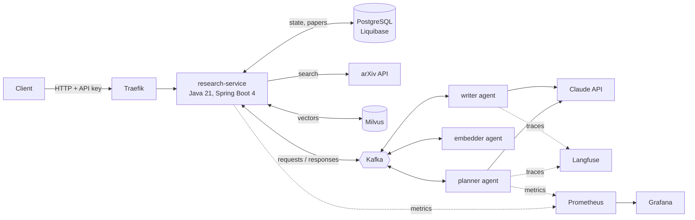

# Research Agent

An event-driven LLM research platform that turns a topic into a cited literature report. A Java orchestrator runs every request as a persistent state machine and delegates the AI work to Python agents over Kafka: a planner writes arXiv search queries, an embedder vectorises papers into Milvus, and a writer produces a report in which every citation is verified against the retrieved sources.

```text
POST /api/research                         {"topic": "evaluation methods for LLM agents"}  ->  202, run id
GET  /api/research/{id}                    status, report, sources, token usage
GET  /api/research/{id}/report             Markdown report with references
POST /api/research/{id}/cancel             cancel an active run
GET  /api/research?page=0&size=20          runs, newest first
GET  /api/admins/research/statistics       run counts per status, total LLM usage   (admin key)
POST /api/admins/research/{id}/retry       return a failed run to the queue          (admin key)
```

Every request carries an `X-API-Key` header. Errors share one body: `{"status": 409, "message": "...", "codes": ["RESEARCH_RUN_NOT_CANCELLABLE"]}`.

## Architecture



Run lifecycle: `PENDING -> PLANNING -> SEARCHING -> INDEXING -> RETRIEVING -> WRITING -> DONE | FAILED | CANCELLED`

| Step | Owner | What happens |
|---|---|---|
| PLANNING | planner agent | Claude writes 1-6 arXiv queries (structured output, a cheaper model than the writer) |
| SEARCHING | research-service | arXiv search with rate limiting, papers stored in PostgreSQL |
| INDEXING | embedder agent + service | papers embedded (bge-small, 384d), upserted into Milvus (HNSW, cosine) |
| RETRIEVING | embedder agent + service | topic embedded, top-k of the papers this run found retrieved from Milvus |
| WRITING | writer agent | Claude writes the report; citations validated, violations sent back for correction |

Kafka topics follow `<domain>_<entity>_<action>`: `research_plan_request`, `research_plan_response`, `research_embedding_*`, `research_report_*`, each with a `_dlt` dead-letter topic.

## Design decisions

- **Persistent state machine, asynchronous steps.** The orchestrator commits the new state, dispatches the step after commit and returns. A step ends only when a response with the same run id, step and attempt arrives. Attempt numbers grow over the whole life of a run, including admin retries, so Kafka redeliveries, late answers from timed-out attempts and responses for cancelled or requeued runs are ignored safely.
- **Retries and recovery in one place.** Agents do not retry failed steps: SDK retries are disabled and every failure becomes an error response. Inside one step the writer may send validation problems back to the model (up to `RA_MAX_CORRECTION_ATTEMPTS`), and each LLM call has a hard timeout, so a step always finishes within `research.step-timeout`. The orchestrator retries a step with a new attempt number up to `research.max-step-attempts`, and a scheduler re-dispatches steps that exceeded the timeout (lost messages, crashed workers). Agents commit Kafka offsets only after the broker acknowledged the response.
- **Admission control.** Requests are queued as `PENDING` and admitted in order while fewer than `research.max-active-runs` runs are active. This bounds concurrent LLM and embedding work, and cost, regardless of incoming traffic.
- **Dead letters instead of poison messages.** A response the orchestrator cannot read goes straight to `<topic>_dlt`; transient failures such as optimistic-lock conflicts are retried first. Agents move unreadable requests to their own dead-letter topic, so one bad record never blocks a partition.
- **Structured outputs with self-correction.** LLM calls return schema-constrained JSON. Rules a schema cannot express (cite only retrieved papers, every inline citation listed in `citedIds`) are checked in code, and violations go back to the model as a follow-up turn, keeping the prompt prefix cacheable.
- **Stateless API-key security.** The client key grants `/research/**`, the admin key also grants `/admins/**`; keys are compared in constant time. Actuator runs on a separate management port (8081) that is not routed by the ingress.
- **Auditing.** Every entity records `created_at/by` and `modified_at/by`; changes made by schedulers and Kafka listeners are attributed to `system`.
- **Observability by default.** Micrometer and Prometheus metrics for runs, step latency, retries and tokens; agent metrics per role; a provisioned Grafana dashboard; Langfuse traces where every agent call of a run is grouped under one trace (the run UUID is the trace id).
- **Offline mode.** `RA_LLM_PROVIDER=fake` swaps Claude for a deterministic provider with the same contract, so the whole platform runs end to end locally and in CI without an API key.
- **Refusal fallback.** Claude requests use server-side fallbacks (`fallbacks="default"`), so a request declined by a safety classifier is re-run on the recommended fallback model instead of failing the run.

## Stack

| Area | Technology |
|---|---|
| Orchestrator | Java 21, Spring Boot 4.1, Spring Security, Spring Kafka, Spring Data JPA, Liquibase, MapStruct, Micrometer, springdoc OpenAPI, virtual threads |
| Agents | Python 3.12, Anthropic SDK (Claude Opus 5 writer, Claude Sonnet 5.5 planner), confluent-kafka, Pydantic, fastembed, prometheus-client, Langfuse SDK |
| Data | PostgreSQL 17, Milvus 2.6, Apache Kafka 3.9 (KRaft) |
| Edge and ops | Traefik 3, Prometheus, Grafana, Langfuse, Kafka UI |
| Delivery | Docker, Docker Compose, Helm chart for k3s, Terraform for AWS, GitHub Actions, GHCR, Trivy |
| Quality | Checkstyle, JUnit 6, Mockito, Testcontainers, pytest, ruff, promptfoo |

## Quick start

Everything runs in Docker. By default the agents use the offline provider, so no LLM key is needed.

```bash
cp .env.example .env
docker compose up -d --build
bash scripts/e2e.sh "retrieval augmented generation evaluation"
```

```bash
curl -X POST http://localhost:8000/api/research \
  -H "X-API-Key: local-api-key" -H "Content-Type: application/json" \
  -d '{"topic": "evaluation methods for LLM agents"}'
```

To use Claude, set `RA_LLM_PROVIDER=claude` and `ANTHROPIC_API_KEY` in `.env`, then `docker compose up -d`.

| URL | Service |
|---|---|
| http://localhost:8000/api/research | API via Traefik |
| http://localhost:8000/api/swagger-ui | OpenAPI UI (authorize with the API key) |
| http://localhost:3000 | Grafana, dashboard "Research Agent" |
| http://localhost:9090 | Prometheus |
| http://localhost:8082 | Kafka UI |
| http://localhost:8081 | Traefik dashboard |

### Configuration profiles

| Profile | Used by | Differences |
|---|---|---|
| `local` | IDE runs and Docker Compose | localhost endpoints and development credentials, topics created on startup |
| `dev` | Helm with bundled infrastructure | topics created on startup, credentials from Kubernetes secrets |
| `prod` | Helm with external infrastructure | topics provisioned outside the service, OpenAPI docs disabled |
| `test` | test suites | fast scheduler intervals, test API keys |

The base `application.yml` holds no endpoints or credentials; they come from the active profile or from environment variables (`SPRING_DATASOURCE_*`, `SPRING_KAFKA_BOOTSTRAP_SERVERS`, `RESEARCH_MILVUS_URI`, `RESEARCH_SECURITY_API_KEY`, `RESEARCH_SECURITY_ADMIN_API_KEY`).

### Tracing with Langfuse

```bash
docker compose --profile langfuse up -d
LANGFUSE_PUBLIC_KEY=pk-lf-local LANGFUSE_SECRET_KEY=sk-lf-local docker compose up -d
```

Langfuse runs at http://localhost:3001 (login `admin@research.local` / `research-admin`). The project and API keys are created on first start.

## Evals

`evals/promptfoo` scores the writer agent on fixed sets of real arXiv sources: citation grounding, source coverage, and an LLM-as-judge rubric for report quality.

```bash
docker build -t research-evals:local evals/promptfoo
# smoke test of the eval harness with the offline provider: checks wiring, cannot fail on quality
docker run --rm -e RA_LLM_PROVIDER=fake -v "$PWD:/repo" research-evals:local \
  eval -c promptfooconfig.offline.yaml --no-cache
# real evaluation with Claude
docker run --rm -e RA_LLM_PROVIDER=claude -e ANTHROPIC_API_KEY -v "$PWD:/repo" research-evals:local
```

The suite is small (two topics) and the judge comes from the same model family as the writer, so treat the rubric score as a regression signal, not an absolute quality measure.

## Kubernetes

The chart in `deploy/helm/research-agent` runs the service and three agent deployments with a Traefik ingress, probes on the management port, Prometheus annotations, generated API keys kept across upgrades, non-root read-only containers, and optional single-node PostgreSQL, Kafka and Milvus (`infra.enabled`, profile `dev`) or external endpoints (profile `prod`). Images come from GHCR: CI publishes `:<sha>` on every push to `main` and `:<version>` for `v*` tags, which is the chart's default tag (`appVersion`).

Local cluster with k3d:

```bash
k3d cluster create research --agents 1 -p "8080:80@loadbalancer"
helm install ra deploy/helm/research-agent -n research --create-namespace \
  --set infra.enabled=true --set agents.llm.provider=fake
kubectl -n research get pods
```

With Claude: `--set agents.llm.provider=claude --set anthropic.apiKey=$ANTHROPIC_API_KEY` (or `anthropic.existingSecret`). The orchestrator must run as a single replica; the chart refuses `researchService.replicas > 1` (see Trade-offs).

### AWS

`deploy/terraform/aws` provisions a single-node k3s environment: VPC, security groups limited to an admin CIDR, EC2 with an encrypted gp3 volume and IMDSv2, Elastic IP, ECR repositories with lifecycle policies, and an IAM role that refreshes an `ecr-credentials` pull secret on the node. State is local; use a remote backend for anything shared.

```bash
cd deploy/terraform/aws && terraform init && terraform apply
REGISTRY=$(terraform output -raw ecr_registry)
aws ecr get-login-password | docker login --username AWS --password-stdin "$REGISTRY"
for image in research-service research-agents; do
  docker pull "ghcr.io/notlhos/$image:0.1.0"
  docker tag "ghcr.io/notlhos/$image:0.1.0" "$REGISTRY/$image:0.1.0"
  docker push "$REGISTRY/$image:0.1.0"
done
helm install ra deploy/helm/research-agent -n research --create-namespace \
  --set image.registry="$REGISTRY" --set "imagePullSecrets[0].name=ecr-credentials" \
  --set infra.enabled=true --set anthropic.apiKey="$ANTHROPIC_API_KEY"
```

## Trade-offs

- **Kafka for three request/reply calls.** HTTP would be simpler for one agent. Kafka was chosen because agents are slow (seconds to minutes), scale independently per role, and must survive restarts of either side: a request waits in the topic while a worker is down, and redeliveries are made harmless by the attempt guard instead of distributed transactions. The cost is more moving parts and a dead-letter path to operate.
- **Milvus instead of pgvector.** PostgreSQL already runs, and pgvector would be enough at this corpus size. Milvus mirrors a production setup where the vector index is shared, grows independently of the relational data and is tuned separately (HNSW parameters, consistency level). `PaperVectorStore` is the single seam to swap it.
- **One orchestrator replica.** Admission counts active runs and then starts pending ones without a database lock. That keeps the scheduler simple and is correct for one replica; scaling out needs `SELECT ... FOR UPDATE SKIP LOCKED` or a scheduler lock.
- **Shared vector index.** A paper is embedded once and reused by every run that finds it; retrieval is filtered to the papers found by the current run, so earlier runs do not leak into a report.

## Limitations

- Single orchestrator replica (see above); agents scale horizontally.
- arXiv allows one request every three seconds, so the search step is serialized across all runs.
- No streaming of progress; clients poll the run resource.
- The end-to-end test in CI calls the live arXiv API and can fail when arXiv is slow or down.
- A run with Claude makes one planner call and one to three writer calls; token usage per run is reported by the API and in Grafana.

## Repository layout

```text
services/research-service   Java orchestrator
  application/              configuration, security, error handling, auditing, Kafka, arXiv and Milvus clients
  core/                     API controllers and DTOs, mappers, entities and repositories, run lifecycle services
agents                      Python agents (planner, writer, embedder) and the offline LLM provider
deploy/helm                 Helm chart for k3s
deploy/terraform/aws        Terraform for a k3s node on AWS
deploy/monitoring           Prometheus config and Grafana provisioning
evals/promptfoo             Writer evals with fixtures from real arXiv papers
LICENSE                     MIT
scripts/e2e.sh              End-to-end check through the running stack
```

## Testing

- `services/research-service` (42 tests): `bash gradlew build` runs Checkstyle (zero warnings allowed), unit tests of the state machine and the admission/recovery scheduler, web tests of security and error responses, repository tests against PostgreSQL, and an integration test that drives a run through real Kafka with scripted agents and checks dead-letter routing (Testcontainers).
- `agents` (24 tests): `pytest` covers message contracts, handlers, the Kafka worker with its dead-letter and undelivered-response paths, citation parsing and the self-correction loop.
- CI runs both suites, `helm lint` with kubeconform, `terraform validate`, the full stack end to end in Docker Compose with the eval smoke test, and only then builds both images, scans them with Trivy and pushes them to GHCR. Actions are pinned by commit SHA.

## Roadmap

- [ ] Streaming run progress over Server-Sent Events
- [ ] MCP server exposing `research(topic)` as a tool for other agents
- [ ] Prompt caching metrics per step in Grafana
- [ ] Multiple orchestrator replicas with locked admission (`SKIP LOCKED`)
- [ ] Faithfulness evals: does the cited abstract support the claim
